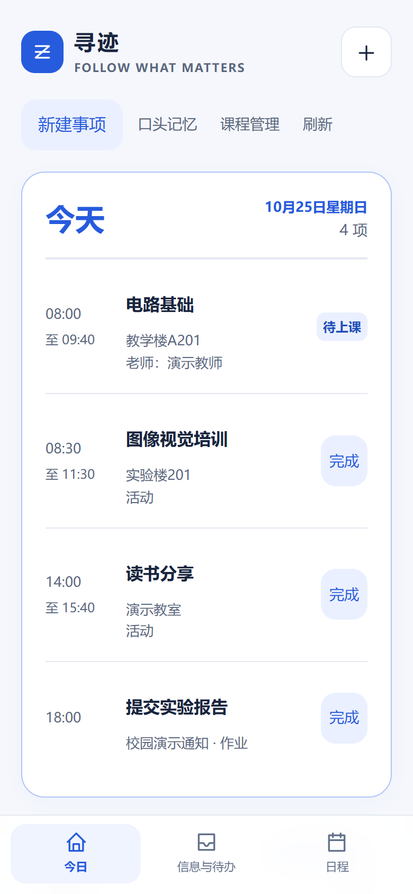
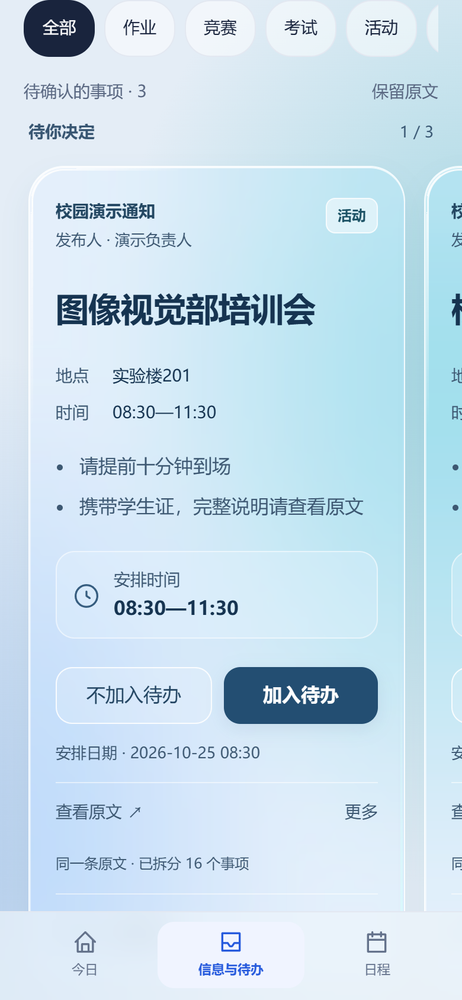
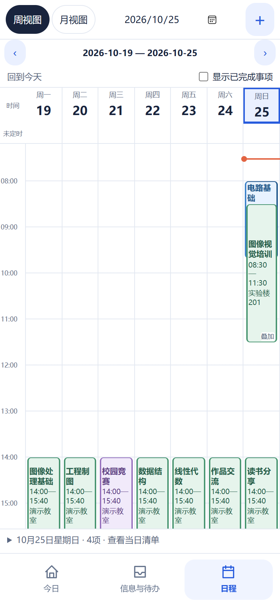
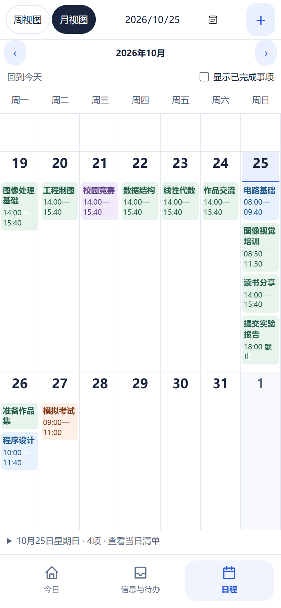

# 寻迹 · 校园信息与日程助手

**把群里的通知，变成自己看得见、安排得清的下一步。**

寻迹是一款 Android 校园信息与日程应用。它将关注 QQ 群中的文字通知整理成事项卡片，由使用者核对并决定是否加入待办，再与课程一起显示在今日、周日程和月日程中。

适用于课程通知、作业提交、考试安排、竞赛报名和校园活动。除了 QQ 通知，也可以手动新建事项，或输入一段自然语言交给 DeepSeek 整理。

**交付版本：v0.36（Android versionCode 37）** · **平台：Android 9 及以上** · [项目仓库](https://github.com/yulongxiaoxing/xunji)

## 下载与安装

交付包包含可直接安装的 APK、本 README、界面截图和项目源码。前往 [v0.36 交付版下载页](https://github.com/yulongxiaoxing/xunji/releases/tag/v0.36)获取：

- [Xunji-v0.36.apk](https://github.com/yulongxiaoxing/xunji/releases/download/v0.36/Xunji-v0.36.apk)：Android安装包。
- [Xunji-v0.36-delivery.zip](https://github.com/yulongxiaoxing/xunji/releases/download/v0.36/Xunji-v0.36-delivery.zip)：完整交付压缩包。
- [SHA256SUMS.txt](https://github.com/yulongxiaoxing/xunji/releases/download/v0.36/SHA256SUMS.txt)：交付文件校验值。

将 APK 传到手机后打开，按系统提示允许本次安装，即可进入寻迹。同一签名的已有版本可以覆盖安装，保留本地数据。安装包不包含开发者的 QQ 登录、密钥、群消息或课表，新安装默认为空数据。

无需配置 QQ 或 AI 就能体验手动新建、今日视图和日程表；需要自动整理通知时，再按后文配置 DeepSeek 和电脑端 QQ 接入。

## 项目解决的问题

校园安排分散在不同群消息中：一条通知往往同时包含活动名称、日期、起止时间、地点和多项要求。只收藏消息，仍需反复翻找和手动抄到日历；直接把每条消息变成提醒，又容易混入无关内容。

寻迹保留原文，先将可执行事项整理出来，再交给使用者确认。确认后的课程与事项按同一条时间线展示，方便查看当天安排和重叠时段。

```text
关注群的新通知 → 保存原文 → AI整理 → 收件箱核对 → 加入待办 → 今日与日程表
手动新建 / 自然语言输入 / 课表文件 ────────────────────┘
```

## 功能介绍

### 1. 指定 QQ 群的信息接入

- 通过电脑端 NapCat 接入 QQ，手机按关注的群号过滤消息。
- 支持搜索群名或群号，管理待关注与已关注的群。
- 首次关注建立历史基线，只接收之后的新消息；取消关注后，已经保存的原文和事项仍保留。
- 保留来源群、发布人和完整文字，方便核对信息依据。

### 2. AI 事项整理与自然语言输入

- DeepSeek 提取事项名称、分类、具体要求和时间信息，同一事项的多条要求放在同一卡中。
- 独立事项可以拆分；没有可执行事项的消息可以不生成卡片。
- “口头记忆”提供文字输入框，支持键入、粘贴，也可自行使用系统输入法语音输入。应用不调用麦克风录音。
- 点击整理后先预览，再确认加入待办。缺失或存在歧义的信息保留待确认，网络失败时保留输入和原文。

例如输入：

> 我明天上午八点半到十一点半有一个图像视觉部的培训会。

整理结果应为“活动 / 图像视觉部培训会 / 实际次日 / 08:30—11:30”。相对日期按输入整理时的北京时间计算，不将培训会笼统当成课程。

### 3. 液态玻璃收件箱与待办决策

- 待确认事项以横向连续排列的玻璃卡片展示，相邻卡片露出，支持跟手拖动、惯性滚动和松手停靠。
- 滑动只切换查看；点击“加入待办”或“不加入待办”才提交决定，成功后下一项补位。
- 支持按分类筛选、搜索、查看原文、编辑事项和可恢复删除；保存失败时保留当前内容。
- 普通待办支持完成与取消，取消后回到收件箱。

### 4. 手动事项与课程导入

- 可直接新建课程、活动、考试、竞赛、作业及其他事项，无需调用 AI。
- 课程、活动、考试和竞赛可填写地点、日期与起止时刻，课程还可填写教师和有限次数/截止日的每周、隔周安排。
- 支持 ICS / WakeUp 文件预览后导入；课程独立管理，保留名称、教室、教师及时间。
- 重复导入保留已有修改和决定；课程按下课时间自动更新完成状态。

### 5. 按日期整合的今日视图

- 以今天、明天、后天和之后已有安排的日期分组，将课程和其他待办放在同一个日期框中。
- 每日按时刻排列，清楚展示起止区间、地点和事项状态。
- 支持前台自动同步和下拉刷新，减少在通知、课表和待办之间来回切换。

### 6. 可视化日程表

- **周视图**：周一到周日同时显示，00:00—24:00 小时时间轴支持纵向滚动，课程与活动按真实起止时间定位。
- **重叠日程**：同一时段叠放展示，露出下层左右边框；点击重合时段可以选择查看各项安排。
- **月视图**：按日直接列出事项名称和时间，纵向滚动浏览整月；只有日期、没有时刻的事项排在当天顶部。
- **日期导航**：切换周/月、选择日期、回到今天，展开当日清单查看完整资料。
- **时间规则**：待确认收件箱不进入正式日程；加入待办后按明确日期展示，未知日期继续留在事项管理中。手动调整不会被自动解析覆盖。

## 界面预览

以下截图来自实际前端界面的虚构演示数据，不包含真实群聊或个人课表。

<table>
  <tr>
    <td align="center">今日视图<br></td>
    <td align="center">玻璃收件箱<br></td>
  </tr>
  <tr>
    <td align="center">周日程表<br></td>
    <td align="center">月日程表<br></td>
  </tr>
</table>

## 三分钟体验

### 不配置账号，先体验本地流程

1. 安装 APK，打开“今日 → 新建事项”，选择“活动”。
2. 填写名称、地点、日期和起止时间，创建待办。
3. 在今日和日程中核对安排，切换周/月视图，查看完整详情。
4. 再新建一条时间重叠的安排，点击周表重合位置查看两条日程。

### 配置 AI 后体验自然语言整理

1. 在“信息与待办 → 设置 → DeepSeek”填写自己的 API 密钥并保存。密钥可在 [DeepSeek 官方平台](https://platform.deepseek.com/)创建，接口使用说明见[官方文档](https://api-docs.deepseek.com/api/deepseek-api/)。
2. 回到今日，打开“口头记忆”，输入上面的培训会示例并点击“DeepSeek整理”。
3. 核对分类、实际日期和08:30—11:30，确认后查看待办及日程。

### 接入 QQ 后体验自动收件箱

配置以下电脑环境，在手机关注一个测试群。由本人向群发送一条合适的新通知，等待原文保存和 AI 整理，再滑动收件箱、查看原文并决定是否加入待办。

## QQ 接入配置

QQ 自动接入需要 **Windows 电脑、Python 3、Android SDK Platform-Tools、USB 调试连接以及 NapCat**。电脑负责 QQ 接入，手机负责原文、AI、待办和日程；只使用本地事项功能时不需要电脑常驻。

1. 从 [NapCat 官方 v4.18.41 发布页](https://github.com/NapNeko/NapCatQQ/releases/tag/v4.18.41)下载 `NapCat.Shell.Windows.Node.zip`。本项目的隔离适配按此版本验证；包类型参见[官方说明](https://doc.napneko.icu/guide/boot/release)。
2. 在源码根目录下解压到 `.codex/napcat-desktop/runtime/`，确认其中有 `node.exe`、`index.js`、`napcat/`。运行包与 QQ 会话不随交付包分发。
3. 安装Android Platform-Tools并将其目录加入PATH（使用Android SDK时默认位于`%LOCALAPPDATA%\Android\Sdk\platform-tools`）；也可在命令中用`--adb`提供完整路径。从系统托盘退出普通电脑版QQ，手机QQ保持登录。连接手机，允许USB调试，并确认`adb devices`的状态为`device`。
4. 双击 `tools/napcat-desktop/start-demo.bat`，或在源码根目录运行：

```powershell
py -3 tools/napcat-desktop/desktop.py start
```

启动脚本自动识别唯一已授权的手机，并建立手机3000端口到电脑13001端口的 USB 转接。连接多台手机或 SDK 路径不同时，可以明确指定：

```powershell
py -3 tools/napcat-desktop/desktop.py start --serial YOUR_SERIAL --adb "D:\Android\Sdk\platform-tools\adb.exe"
```

5. 首次启动自动生成本机独立口令。打开本地 `.codex/napcat-desktop/local-secrets.json`，仅将 `onebot` 字段填到手机“设置 → QQ连接 → 本机连接口令”，点击“保存并连接”。这个文件不上传、不分享。
6. 需要登录时，用手机 QQ 扫描 `.codex/napcat-desktop/runtime/napcat/cache/qrcode.png` 并由本人确认；等待连接在线。
7. 在手机“关注群”中搜索并关注测试群，再发送一条新通知验证收信。首次关注之前的历史消息不会自动导入。

检查状态、恢复转接或停止独立接入端：

```powershell
py -3 tools/napcat-desktop/desktop.py status
py -3 tools/napcat-desktop/desktop.py link
py -3 tools/napcat-desktop/desktop.py stop
```

若启动时使用了自定义`--serial`或`--adb`，后续`link`也传入相同参数。

接口仅绑定本机回环地址，OneBot端口13001，WebUI端口16098；不暴露到公网。演示时保持电脑唤醒、联网和USB连接，普通电脑版QQ不要同时登录。同账号冲突、登录过期或二维码过期时，先按提示处理，再检查连接状态。

## 技术结构

| 层次 | 实现 | 作用 |
| --- | --- | --- |
| Android 宿主 | Java、系统 WebView | 应用生命周期、文件选择、原生桥接与本机服务 |
| 界面 | HTML / CSS / JavaScript | 今日、玻璃收件箱、事项编辑和周/月日程 |
| 本地存储 | SQLite v10 | 原文、事项、时间区间、用户决定和缓存 |
| AI | DeepSeek API | 群文字提取与自然语言事项整理 |
| QQ 接入 | NapCat、OneBot HTTP、USB reverse | 指定群消息接入；Python脚本管理电脑端环境 |

群通知与口头记忆使用各自的整理规则。原文与提取结果分开保存，用户决定和人工修改受到保护；同版本相同正文可复用本机缓存。AI 输出仍需结合原文核对。

## 从源码构建

在 Git 仓库根目录执行。若使用交付压缩包，先进入解压后的 `source/` 目录。

准备 Windows PowerShell、JDK（包含javac/java/jar/keytool）、Android SDK build-tools 36.0.0 及已安装的 Android platform。项目使用 Java + WebView，**不使用 Gradle**。

```powershell
& .\tools\notification-probe\build.ps1
# SDK不在默认路径时：
& .\tools\notification-probe\build.ps1 -SdkRoot "D:\Android\Sdk"
```

脚本自动运行Java检查、编译、打包并验证签名。输出文件为`tools/notification-probe/build/xunji-notification-test.apk`。

交付APK沿用开发者原有演示签名，私有签名文件不随源码分发。**新电脑首次构建会生成不同签名，不能覆盖已经安装的交付APK**；同一电脑保留签名文件后，才能覆盖升级由它自己构建的版本。遇到签名不一致时，不要卸载或清空有真实数据的应用来强行安装；请使用独立测试设备，或继续使用同签名的交付安装包。

```powershell
adb -s YOUR_SERIAL install --no-streaming -r tools/notification-probe/build/xunji-notification-test.apk
adb -s YOUR_SERIAL shell am start -W -n cn.xunji.probe/.DemoActivity
```

## 项目目录

```text
tools/
  notification-probe/          Android应用、WebView界面、规则与测试
    assets/index.html          主界面与交互
    assets/*rules.md           AI整理规则
    src/cn/xunji/probe/        原生桥接、SQLite、导入及接入服务
    tests/                    Java、SQLite和浏览器回归
    build.ps1                 构建与签名入口
  napcat-desktop/              电脑端接入管理、启动器与回归
docs/images/                  虚构数据的实际界面截图
README.md                     当前交付版说明
```

## 验证记录

交付 APK 于2026-10-25完成以下验证：

- 205项Java检查、122项独立Android SQLite断言、十一组浏览器界面回归；APK构建与v3签名验证通过。
- 真机验证培训会原句的DeepSeek预览，以及用户自行发送的新QQ通知从接入、原文保存、AI整理到待确认收件箱的链路。
- 口头记忆预览与保存的空日期保持一致，未知日期不会在保存时重新补成确定日期。

本次交付整理另增加电脑端首次启动、旧口令保留、单设备识别和多设备选择的六组回归。浏览器测试使用模拟桥接与触屏事件，不能替代所有机型的真实手指体验。

```powershell
node tools/notification-probe/tests/ui/inbox-glass.cjs
node tools/notification-probe/tests/ui/calendar-overlay-month.cjs
& .\tools\notification-probe\test-store.ps1 -Serial YOUR_SERIAL
py -3 -m unittest discover -s tools/napcat-desktop/tests -v
```

界面回归需要 Playwright 和 Edge，可通过 `PLAYWRIGHT_MODULE`、`EDGE_PATH` 指定安装位置。SQLite回归使用独立测试包，不操作寻迹的真实数据库。

## 数据与使用说明

- 事项和原文保存在手机本地；DeepSeek密钥使用Android Keystore加密保存，系统备份关闭。
- 待整理的关注群文字、点击整理的自然语言文字会发送至DeepSeek；导入ICS不发送给AI。
- 仅处理关注群的新文字消息，不自动向群发送消息；本次交付未将图片或附件作为识别输入。
- 手机端需要网络才能调用AI；网络不可用时，已有事项、手动新建、课程和日程仍可使用。
- 新版WakeUp分享口令可能受服务端版本限制，课表体验优先选择ICS或已支持的文件入口。
- 请用演示数据投屏，妥善保管API密钥、接口口令和QQ登录会话。安装升级采用原位覆盖，不要通过卸载或清空数据解决连接问题。

第三方组件由其各自项目维护，本仓库不分发NapCat运行包，也不重新授予第三方许可。
