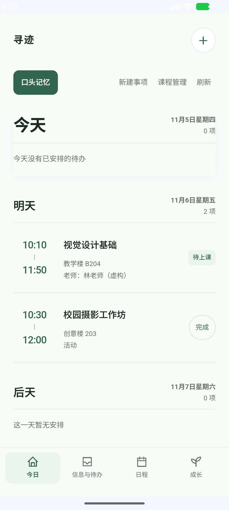
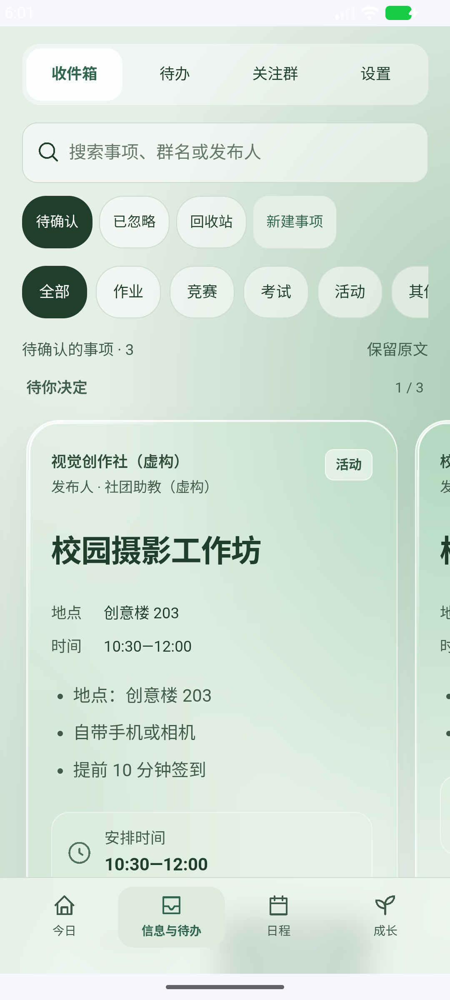
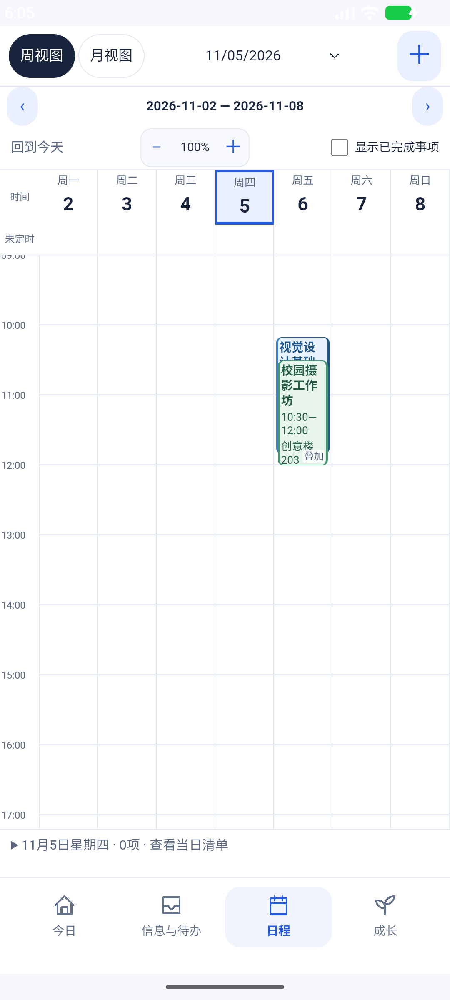
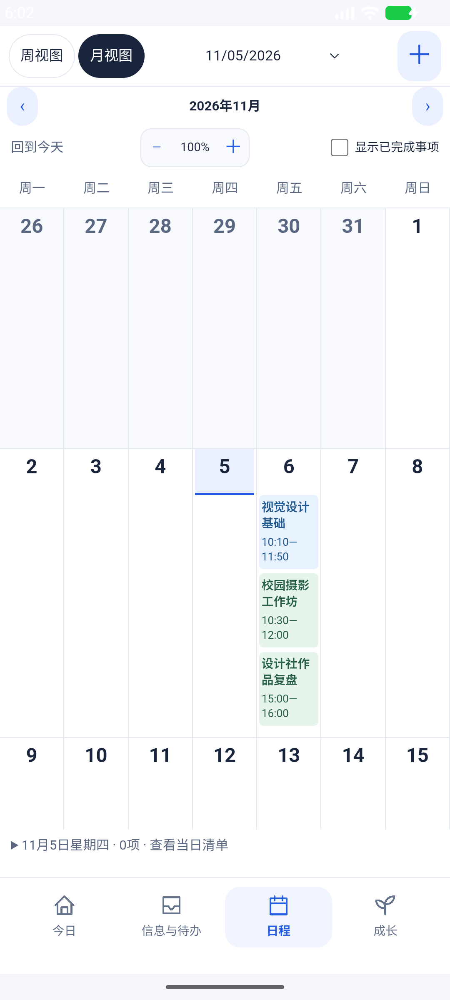
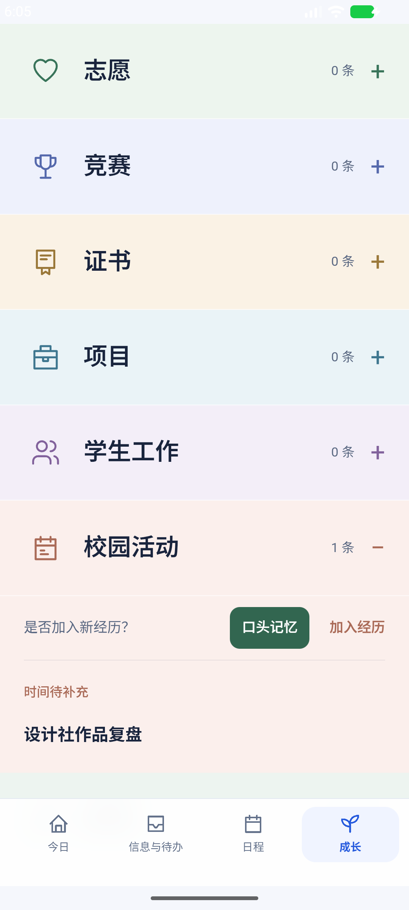

# 寻迹 · 校园信息与日程助手

寻迹是一款 Android 应用。它把校园群通知整理成可以核对的事项，和课程一起放进日程，并把值得保留的参与经历归入成长档案。

## 下载

[寻迹 v0.58 双版本发布页](https://github.com/yulongxiaoxing/xunji/releases/tag/v0.58) · Android 9 及以上

| 版本 | 首次安装 | 适用场景 |
| --- | --- | --- |
| [黑客松演示版](https://github.com/yulongxiaoxing/xunji/releases/download/v0.58/Xunji-v0.58-Hackathon.apk) | 预置虚构通知、课表和活动。无需联网或账号即可核对原文、接收待办、查看时间冲突和录入经历 | 路演、评审体验、录屏和 Claude Code 视频制作 |
| [实际应用版](https://github.com/yulongxiaoxing/xunji/releases/download/v0.58/Xunji-v0.58-Actual.apk) | 从空收件箱、空日程和空成长档案开始。支持手动新建、课表导入，也可自行配置 DeepSeek 与 QQ 接入 | 日常使用 |

两个 APK 可以装在同一台设备上，分别保存数据。[使用与构建指南](docs/RUNNING.md) · [Claude Code 录制手册](docs/VIDEO.md) · [成长档案使用说明](docs/GROWTH.md)

## 用户痛点

群聊里的作业、考试、报名和活动通知容易被讨论淹没。即使找回原文，也得手动拆出时间、地点和要求，再对照课表判断能否参加。活动结束后，个人参与经历和证明材料又散落在消息、相册和笔记里，准备评优或求职材料时还得重新翻找。

## 目标人群

- 同时关注多个课程群、班群和校园组织群的大学生。
- 经常需要在课程、作业、竞赛和社团活动之间协调时间的学生。
- 希望持续记录项目、竞赛、志愿服务和校园活动，为评优、实习或求职准备材料的学生。

## 核心功能

| 功能 | 用户可以做什么 |
| --- | --- |
| 接收通知 | 关注指定 QQ 群，通过电脑端 NapCat 和 USB 接收文字通知；也能直接粘贴原文 |
| 整理与决策 | 使用 DeepSeek 提取事项、要求、时间等信息，在收件箱对照原文，编辑、加入待办或忽略 |
| 今日与日程 | 手动建事项、使用文字口述整理，或导入 ICS / WakeUp 课表。按今日、周表和月表浏览课程、时间区间和截止任务，点开重叠时段查看冲突 |
| 执行与归档 | 跟踪完成状态，为实际参与的活动建立成长记录。支持人工录入、候选核对、按类查看和附本地证明图片 |

## 产品闭环

1. **收进来**。由指定 QQ 群、粘贴原文、手动输入或课表文件进入寻迹。
2. **看清楚**。AI 把文字整理成可执行事项；用户核对原文，决定是否加入待办。人工录入和课表导入走自己的确认入口。
3. **排时间**。有明确日期的待办和课程进入日程，重叠安排能分别点开，未定日期的事项仍可在待办中处理。
4. **做完并沉淀**。用户可完成待办，也可由应用按明确时间更新完成状态。有成长价值的已完成事项可以成为候选，经本人核对实际参与后收入成长档案，关联来源并按需保存证明。

事项和经历存放在应用本地。配置 AI 后，相应文字会发送给 DeepSeek 整理。真实 QQ 自动接入需要 Windows 电脑、NapCat 和 USB 连接，详情见 [使用与构建指南](docs/RUNNING.md)。

## 界面参考

以下截图来自寻迹 v0.58 黑客松演示版，使用虚构数据。周表展示课程和工作坊的时间重叠，成长档案展示由已完成事项建立的经历。

<table>
  <tr>
    <td align="center">今日 </td>
    <td align="center">收件箱 </td>
  </tr>
  <tr>
    <td align="center">周表 </td>
    <td align="center">月表 </td>
  </tr>
  <tr>
    <td align="center" colspan="2">成长档案 </td>
  </tr>
</table>

应用使用 Java、Android WebView 和 SQLite。构建方式见 [使用与构建指南](docs/RUNNING.md)。[v0.36 历史发布](https://github.com/yulongxiaoxing/xunji/releases/tag/v0.36)
